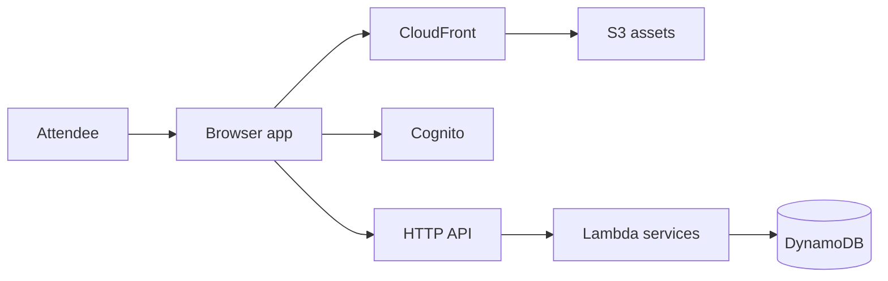
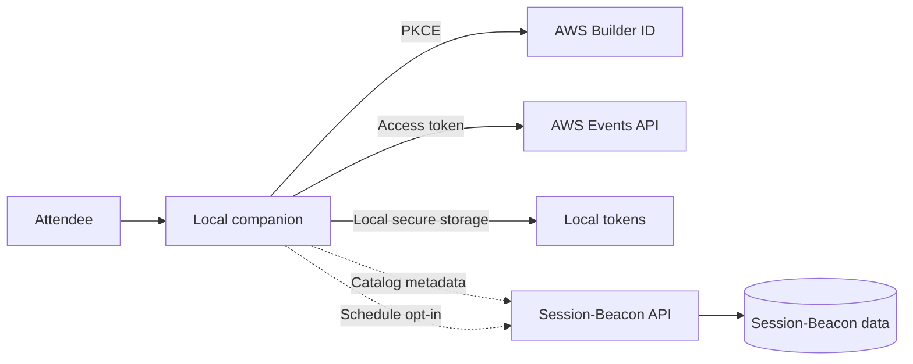
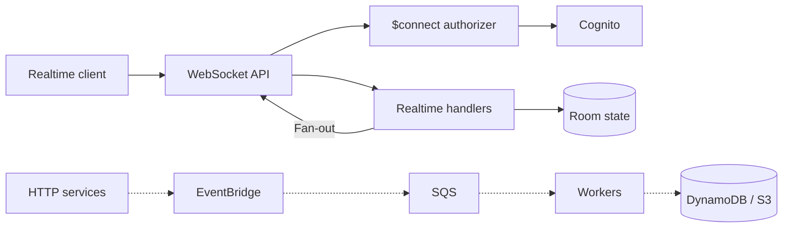
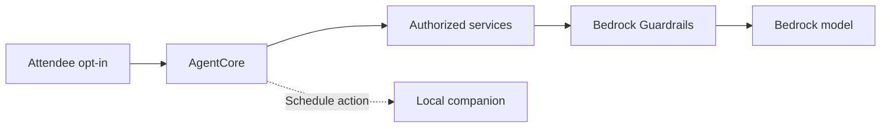

# Session-Beacon Architecture

## Scope and Status

This document separates the **target architecture**

## System Overview

Session-Beacon is built on a serverless, event-driven architecture on AWS:

- **Frontend**: React/Vite SPA hosted on S3 + CloudFront
- **API**: Lambda functions behind API Gateway (HTTP API)
- **Data**: DynamoDB (primary), ElastiCache (optional), S3 (reports)
- **Real-Time**: WebSocket API for breakout rooms and virtual tables
- **AI**: Amazon Bedrock (Claude models) with tiered fallback
- **Auth**: Cognito (platform) + AWS Builder ID (local companion)

## Core Services

### DiscoveryService

- Lists, filters, searches sessions
- Integration with AWS Events API (via local companion)
- Caching layer (DynamoDB + ElastiCache)

### TeamService

- Team CRUD operations
- Membership management
- Team invitations via email (SES)

### ItineraryService

- Session additions to shared team itineraries
- Conflict detection (time-based overlaps)
- Coverage analysis (track distribution)

### RecommendationEngine

- Bedrock/Claude integration with 4-tier fallback
- Scoring algorithm (role, interests, experience, history)
- 24-hour caching

### Real-Time Services

- WebSocket connection lifecycle (, )
- Message routing and fan-out
- Room/table presence tracking

## Architecture Diagrams

### 1. App and AWS Context

Target only: the browser uses the hosted Session-Beacon identity and API. Team itineraries are Session-Beacon data.

### 2. Companion PKCE, Catalog, and Separate Schedule Consent

Target only: local Builder ID tokens never reach the hosted API. Catalog sync and personal schedule sync are distinct; schedule sync is off by default and separately revocable.

### 3. Realtime and Asynchronous Events

Target only: the WebSocket API is separate from HTTP; `$connect` validates a Cognito session and derives identity. Dashed flow shows asynchronous processing.

### 4. Optional AI and AgentCore Path

Target only: agents run only after attendee opt-in and within authorized scope; personal schedule operations still go through the local companion.

## Services and Boundaries

- **Catalog and planning:** source-aware catalog data; Session-Beacon team plan remains distinct from an AWS Events API reservation.
- **Identity:** Cognito for hosted APIs; validate caller IDs against Cognito `sub` or authorized scope. Builder ID PKCE is local to the companion.
- **Realtime:** separate WebSocket API; no reusable credentials in URLs; `$connect` Lambda authorizer derives identity server-side.
- **AI:** recommendations use 0–1 relevance scores and a 24-hour cache; all Bedrock attempts/fallback share a five-second end-to-end budget. AgentCore is an opt-in target capability; its implementation is required by the task plan but was not found in the repository.
- **Virtual tables:** create at 85% capacity (21/25) only when enabled and fewer than five exist for the track.
- **Privacy and SLOs:** personal data deletion/anonymization within 30 days; non-PII audit records one year; HTTP p95 ≤500 ms excluding Bedrock; search ≤200 ms; WebSocket p95 ≤100 ms end-to-end; availability 99.9% over 30 days.
